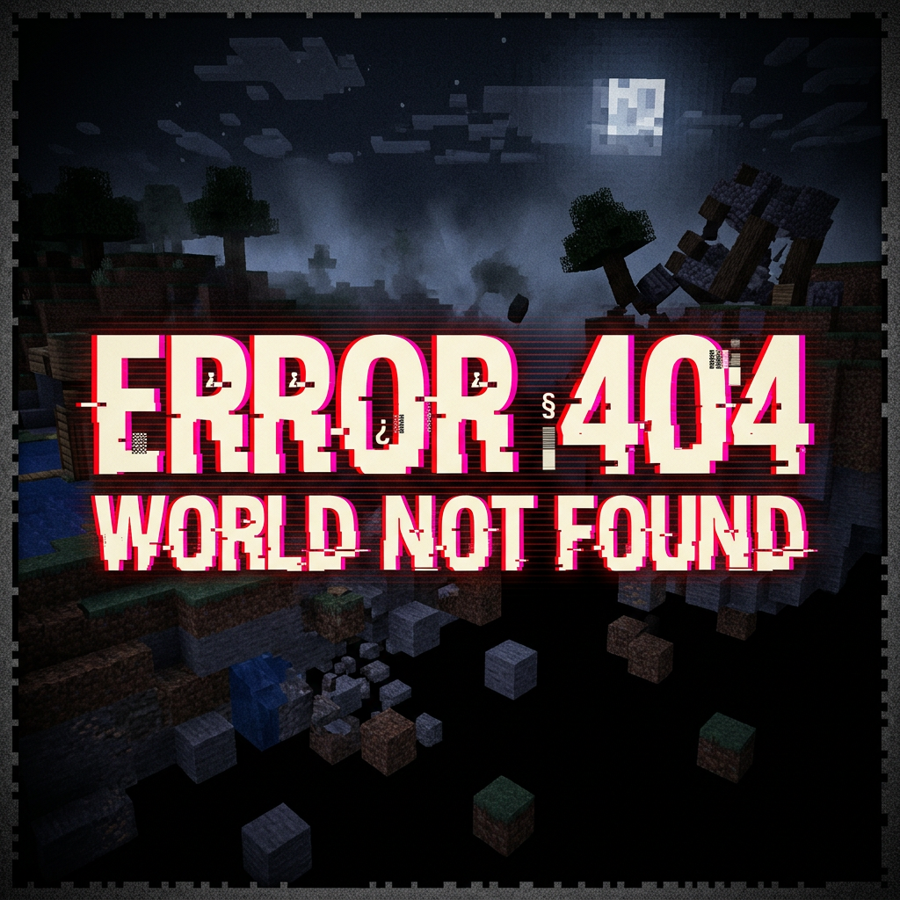
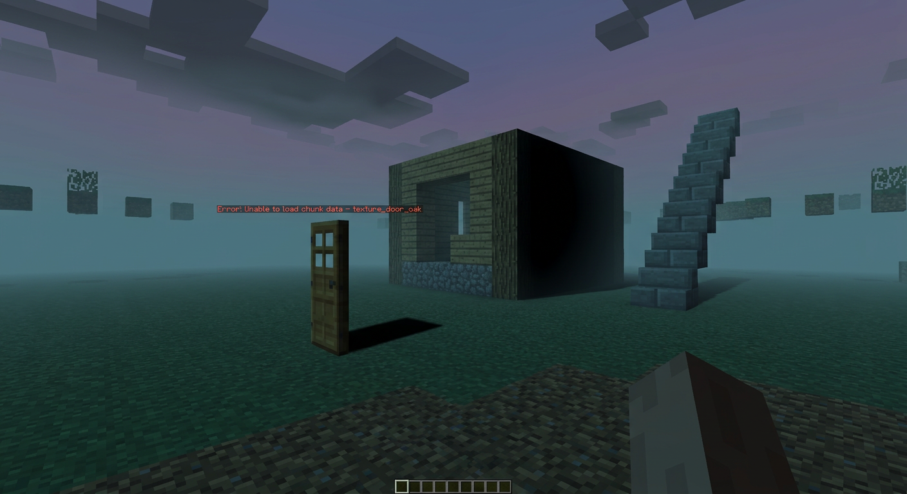
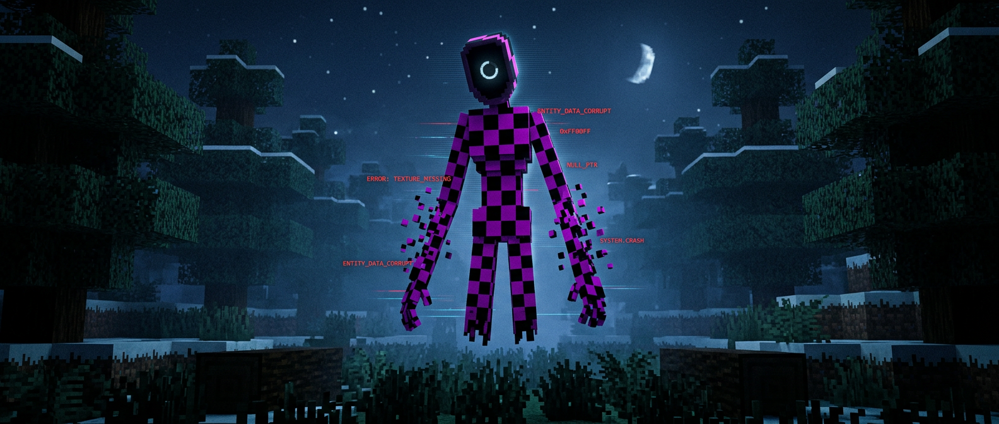
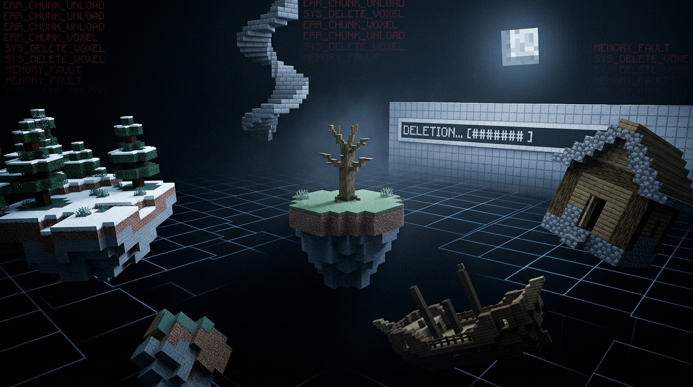

# ERROR 404: WORLD NOT FOUND

> *The world is being deleted. He is the one deleting it.*

Minecraft **Java 1.21.11** (Fabric) ke liye ek slow-burn horror mod.
Tum apni normal duniya join karte ho — aur dheere dheere woh **delete hona shuru** ho jaati hai.



---

## Idea ek line me

Chunks gayab hote hain, unki jagah **ajib structures** ugte hain (aadha ghar, aasman tak seedhi, tumhare purane base ki galat copy),
aur duniya ke "integrity" ke saath ek entity aa jaati hai — **422: The Unprocessable** — jo tumhe duniya ka hissa nahi maanti.

## 404 + 422 = ek hi lore

| Error | Matlab | Mod me |
|---|---|---|
| `404` | *Not Found* | Tumhari duniya, uske chunks, uske structures — sab "nahi mile" ho rahe hain |
| `422` | *Unprocessable Entity* | Woh cheez jo is duniya ko process nahi kar pa rahi... aur tum bhi uske liye process nahi ho rahe |

ERROR 422 (creepypasta mod) se **inspiration** hai, copy nahi — entity, texture, behaviour, sounds, sab original.

---

## Gameplay

**World Integrity 100% → 0%.** Integrity girti hai jab tum explore karte ho, chunks load hote hain, 422 paas aati hai.
Player ka goal: **8 Data Fragments + Anchor Core** bana ke *The Last Chunk* par duniya bacha lena.

| Phase | Naam | Duniya kya karti hai |
|---|---|---|
| P0 | **SIGNAL** | Chup, reverb, ek galat block, ek aadhi chat line |
| P1 | **DESYNC** | Render me holes, sun stutter, peeche 1 kadam ki awaaz, pehla silhouette |
| P2 | **DELETION** | Chunks sach me delete, anomalies spawn, 422 stalking |
| P3 | **CASCADE** | Deletion tez, structures khud mit-te hain, light khaa rahi hai |
| P4 | **ANNEXATION** | Duniya floating fragments, 422 hunt, sirf Last Chunk bacha |

### Chaos: "kuch bhi ho sakta hai" (v0.8)

DELETION phase ke baad, har 1–3 minute me duniya kuch aisa karti hai jo nahi hona chahiye:

| Event | Kya hota hai |
|---|---|
| `chunk` | ek **20x20 block region** tumhare paas, wave-by-wave girta hua (sound + particles) |
| `inventory` | hotbar ka saaman apni jagah badal leta hai (kuch delete nahi hota) |
| `death` | bina toofan ke bijli, aur death screen: *"this player is not in the save file"* |
| `doors` | 20 block ke andar saare darwaze ek saath khul jaate hain |
| `sound` | tumhare theek peeche full volume awaaz — mudo to kuch nahi |
| `lightning` | jis block par tum abhi kadam rakhne wale the, wahan bijli |
| `mobs` | tumhare peeche zombie/skeleton/creeper/enderman spawn, pehle se tumhe target karke |
| `teleport` | 8–18 block door phenk diya (deewar ya lava me nahi) |
| `message` | tumhare hi naam se ek fake diagnostic chat line |
| `night` | dopahar me hi raat — sun hilta nahi, duniya hilti hai |
| `hunger` | bhookh turant gir jaati hai, koi reason nahi (aakhri 2 point nahi jaate) |
| `silence` | 24 block ke andar **saari awaazein** 8 second ke liye band |

### Commands chhupe hue hain (v0.9.1)

Koi bhi horror mod apni command list dikha deta hai — `/summon`, `/chaos`, `/phase`. Woh list padhna
hi aadha darr khatam kar deta hai. Isliye poora `/error404` tree **register hota hai par dikhta nahi**:

- server operator (permission 2) ko hamesha dikhta hai
- singleplayer host (cheats on) ko dikhta hai
- **koi bhi player `/error404 enable` chala kar khol sakta hai** — sirf yahi ek command gate ke bahar hai,
  warna jis server ka woh admin nahi hai uske liye koi raasta hi nahi
- `/error404 disable` se dobara chhupa do; gate session-based hai, server restart par khud reset

Mod khud chalta rehta hai — kisi command ki zaroorat nahi. Commands sirf testing ke liye hain.

### Jumpscares (v0.9.1)

Ek jumpscare sirf tab aata hai jab duniya me uski **wajah** ho — timer par kabhi nahi. Paanch triggers:

1. 422 tumhe dekh kar mudta hai (window rule)
2. tumhare neeche chunk collapse ka countdown shuru hota hai
3. koi hit tumhe quarter health par chhod deta hai
4. 15 block ke andar koi structure appear hota hai
5. ANNEXATION me 422 tumhe chhoo leta hai

Rules: ek player ke liye 2 minute me ek, DELETION se pehle kabhi nahi, anchor zone me kabhi nahi,
`chill` me kabhi nahi, aur session ke pehle minute me kabhi nahi. Photosensitivity mode static plate
aur flash hata deta hai — chehra rehta hai, strobe nahi.

### Deranged (disturbing) layer (v0.9.1)

Jumpscare chhalaang deta hai. Yeh layer **rok deta hai**:

- **Tunnel vision + desaturation** — integrity girti hai to screen kinaron se band hota jaata hai aur
  rang nikalta jaata hai. Koi event nahi, koi sound nahi — bas duniya dheere dheere galat hoti jaati hai.
- **Intruder** — bahut kabhi-kabhi, screen ke neeche wale kone se ek kaala silhouette guzarta hai,
  0.6 second me. Woh entity nahi hai, uski hitbox nahi hai, aur woh jaane se pehle tum sure nahi ho paoge.
- **Naam ki sign** — ek sign jispar **tumhara naam** likha hai, wahin rakha hua jahan tum ek ghante pehle
  khade the, aur jise tumne kabhi banaya nahi.
- **Tumhare tode hue blocks ka ghar** — wahi block types jo tumne toda, unse bani 3x3 hut, andar ek bed,
  aur koi darwaza nahi.
- **Renamed drop** — tumhara hi item, tumhare hi naam se, tumhare pairon me.
- **Death markers** — obsidian ke pillars, ek tumhari har death ke liye, 100 block door.

Anchor zone me chaos **kabhi** nahi hota. `/error404 chaos off` se poora band, `chaos fire <event>` se ek test.

### Sab jagah, ek saath (v0.9.2)

Pehle Nether ya End me jaana asal me escape tha: 422 wahan follow nahi karta tha, chaos band ho jaata
tha, deletion front wahan pahunchti hi nahi thi. Ab har system har dimension me chalta hai — aur
anchor core bhi sirf apni dimension me protect karta hai, to "safe room" banane ke liye usi jagah
anchor lagana padta hai jahan tum ho. Zone apni dimension yaad rakhte hain, isliye Nether ka hole
overworld me nahi khulta. `restore` bhi per-dimension hai.

### Ban layer (v0.9.2) — default **off**

`banLayer` ek alag, jaan-boojh kar hostile layer hai. Ye "creepy" nahi, ye **anti-player** hai —
cheezein cheenta hai, darata nahi:

| Event | Kya jaata hai |
|---|---|
| BED DENIAL | tumhara spawn point, bina bataye |
| HOME EVICTION | jis bed me so rahe ho, wo aur uske aas-paas ka floor |
| NAME THEFT | tab list me tumhara naam, 30 s ke liye |
| DOOR SEAL | jis darwaze se aaye, wo peeche se |
| INVENTORY RANSOM | ek item type, 300 blocks door chest me |
| SLOW THEFT | aadha stack, koi message nahi |
| THE LOCKDOWN | ANNEXATION me 15% par, ek baar, sab kuch |
| MOTD capture | server multiplayer list me apna naam badal deta hai |

Default off kyunki ye asli me hostile hai, aur kyunki ek mod jo kisi ka server permanently
mislabels kar de wo malware hai, horror mod nahi. On karne ke baad `/error404 restore`,
`/error404 banlayer off`, config off, ya server stop — chaaron se poora undo hota hai.

### Presence (v0.9.2 → v0.9.3) — bina kisi entity ke

Duniya me kuch nahi hai. Sirf awaazein, un jaghon se jahan ek asli aadmi hota:

- peeche se aate huye **chaar kadam**, jo ruk jaate hain
- **teen knocks** us darwaze par jis taraf tum nahi dekh rahe
- tumhari **apni saans**, zara si side me, zara si zyada loud
- **v0.9.3:** ek darwaza **peeche se khulta hai** (darwaza jaisa tha waisa hi rehta hai — tum wapas
  jaake band darwaza dekhte ho aur apni yaad par shak karte ho)
- **v0.9.3:** base ke **andar kadam**, jahan tum ho
- **v0.9.3:** 24 block ke andar kisi **chest ka lid khulta hai**, kuch nikalta nahi

Aur DESYNC se hi ek early cue (whisper only, face nahi): jo player apni duniya saaf rakhta hai, use
bhi pehle ghante me pata chal jaata hai ki usne kya install kiya hai.

**MOTD (v0.9.2 → default v0.9.3):** DELETION se server multiplayer list me khud ko rename karta hai.
Ye `banLayer` ke bina bhi hota hai — mod ka sabse tez ban khinchne wala hissa, kyunki ye player ka
kuch nahi, server owner ki cheez badalta hai. `/error404 restore` aur stop par wapas.

### Chunk collapse dikhta hai (v0.8.1)

Pehle chunk kahin door gayab hota tha aur pata bhi nahi chalta tha. Ab do tarah se hota hai, aur dono
dikhte hain:

- **Saamne wala chunk** — tumhare view cone ke andar, 3–9 chunk ki doori par, 1024 blocks tak ek saath
  girte hain (sound + particles + turant client resync, to hole banta hua nazar aata hai)
- **Tumhara apna chunk** — CASCADE ke baad, pehli death ke baad. 9 second ka announcement
  (*YOU ARE STANDING IN A DELETED CHUNK*), actionbar countdown, tez hota heartbeat. Chunk jaata hai:
  andar rahe to void me teleport + 8 damage aur server sabko batata hai ki tum apne chunk ke saath
  delete ho gaye; nikal gaye to woh bhi batata hai.

Sab kuch journal me likha jaata hai — `/error404 restore` sab wapas laata hai.

### Creepy title screen (v0.8.1)

Built-in resource pack (`Error 404: World Not Found - title screen`, default **on**, Resource Packs me
off kar sakte ho):

- deleted world ka **original panorama** — terrain beech me khatam (jagged cut), void ke upar tairte
  blocks, skyline pe ruins, aur ek 3:1 silhouette jo rotation ke saath wapas aata hai
- **original `ERROR 404 / WORLD NOT FOUND` wordmark** (pehla letter corrupted, ek slice shifted) aur
  `NULL EDITION` bar — vanilla logo ki jagah
- scanlines, chalti hui error lines, kabhi-kabhi static burst, aur stack-trace splashes

### 422 kitni khatarnak hai (v0.7)

Ye ek "boss" nahi hai, ye ek **cheez** hai jo tumhe process nahi kar pa rahi. Isliye uske paas health bar
nahi hai — uske paas **rules** hain:

| Rule | Kya hota hai | Kaise bachna hai |
|---|---|---|
| **Contact** | 3 block ke andar aate hi hit (6–10 dmg, silent) | door raho, anchor zone me jao |
| **Stare** | 3 sec se zyada dekha → 3 dmg/sec, blindness, nausea. Har 3 sec me damage badhta hai | nazar hatao — **dekhna hi galti hai** |
| **Chase** | tum use nahi dekhte → woh 2.5–10 block ka jump karke paas aa jaati hai | peeche mat dekho, seedha bhaago |
| **Walls** | raasta band? woh deewar tod deti hai (realBlockDeletion on hone par) | deewar me chhupna kaam nahi karta |
| **Sleep** | CASCADE ke baad sote hue pakad leti hai; bed tod deti hai | sone se pehle check karo ki woh paas nahi hai |
| **Darkness** | ANNEXATION me 20 block ke andar andhera aura | torch/max light, ya anchor zone |
| **Feeding** | har player death usse tez karta hai | — |
| **Mercy** | tumhe maarne ke baad woh 5 minute ke liye chali jaati hai | apna saanp samet lo |
| **Anchor** | anchor zone me woh **kabhi** nahi aati | yahi ek safe jagah hai |
| **Path memory** | CASCADE ke baad woh tumhara **ek minute purana raasta** chalti hai, block by block | raasta seedha rakho, chakkar mat kato |
| **Prediction** | woh wahan jaati hai jahan tum **2 second baad** hoge | rukna sabse kharab option hai |
| **Habits** | woh seekhti hai: tum zameen ke neeche chhupte ho? khade rehte ho? torch rakhte ho? | behaviour badlo |

Screen bhi jhooth bolta hai: uske paas hone par vignette sikudta hai, red/cyan seam aata hai, aur
screen tear hoti hai. `photosensitivity` on karne par ye sab 70% kam ho jaata hai.

**Difficulty presets** (`/error404 difficulty <chill|standard|nightmare>`, live switch):
`chill` = woh sirf dekhti hai · `standard` = upar wala table · `nightmare` = contact 10, stare 5+2/stage,
10 tick me deewar todti hai, phase 1 se hi neend se utha deti hai, 3 ek saath.

### 422 ka do-faced AI (locked design)

**P1–P3 tk woh classic stalker hai:** fog me khadi rehti hai, out-of-frame move karti hai, tumhare paas aakar rukti hai.
**P4 (endgame) me signature rule unlock hota hai:**

> **422 ko dekhna = damage. Nazar hatana = safe.**

3 second se zyada dekha → static, item "unprocessable", chunk ko nuksaan. Ignore kiya → woh chali jaati hai.
Usse ladna nahi hai — pehle usse **bachna** hai, endgame me usse **dekhna seekhna** hai (ya na dekhna).

### Anomaly structures

Prebuilt nahi — ek ruleset se ad-hoc bante hain, isliye har playthrough alag:

<a href="docs/concept/anomaly-structures.png"></a>

`null_hut` (aadha ghar) · `staircase_to_nowhere` (aasman tak seedhi) · `memory_of_home` (tumhare base ki galat copy) ·
`loadbar_wall` (100% hote hi chunks delete) · `mirror_village` (frozen villagers, sab tumhe dekhte hain) ·
`chunk_seam` (do biomes ki galat silaai) · `the_sinkhole` · `inverted_tree` · `door_to_room` · `archive` · `revoke` event

### 422: The Unprocessable

<a href="docs/concept/entity-422-concept.png"></a>

3 block lambi, patli, pair nahi — 0.2 block float karti hai. Body par white terminal error text aur magenta
"missing texture" checker patches. Chehra nahi — khaali head ke andar ek **loading ring** ghoomta hai.
10 block ke andar aate hi uska chehra **tumhara hi chehra** ban jaata hai (still frame — bilkul galat lagta hai).



---

## Difficulty preset: HARDCORE (locked)

- Chunks sach me delete hote hain, structures khud mit-te hain (revoke), 422 light aur blocks khaati hai.
- **Lekin** hardcore ka matlab ye nahi ki tumhara save mar jaaye: session start par **world backup** (region zip),
  aur DELETE ending default me sirf **rename + backup** karta hai (`destructiveEnding=false`).
  Chaho to config me `destructiveEnding=true` karke poora "save gaya" wala experience le sakte ho.
- Fairness ke non-negotiable rules (hardcore me bhi): player ke 8 block ke andar deletion nahi,
  chests/beds/spawn protect, creative/spectator skip, `/error404 stop` + `/error404 restore` hamesha on.

## Safety (pehle se soch liya)

- Session start par **world backup**, default ending me **rename + backup** (real delete nahi).
- Player ke 8 block ke andar koi deletion nahi; chests/beds/spawn protect.
- Creative/spectator skip. `/error404 stop` aur `/error404 restore` hamesha available.
- Photosensitivity flag (rapid flashing off).
- Mod khud game/server crash nahi karta — crash screen sirf ek overlay hai.

---

## Docs

- 📖 **[GAME_DESIGN.md](docs/GAME_DESIGN.md)** — pura design: phases, anomalies, entity AI, endings, commands, loot
- 🛠 **[ROADMAP.md](docs/ROADMAP.md)** — 1.21.11 Fabric technical plan, milestones v0.1→v1.0, risks, CI
- 🏷️ **[LISTING.md](docs/LISTING.md)** — store listing copy + art (`docs/art/banner.png`, `docs/art/icon_400.png`, generated by `tools/gen_promo.py`)
- 🎨 **[docs/concept/](docs/concept/)** — concept art (logo, entity, anomalies, void)

## Install

1. **Fabric Loader 0.20.1+** for Minecraft **1.21.11** ([installer](https://fabricmc.net/use/installer/))
2. **[Fabric API 0.141.6+1.21.11](https://modrinth.com/mod/fabric-api)**
3. `error404-0.6.0.jar` from the [latest release](https://github.com/TCL-Team/Error-404-World-Not-Found/releases/latest)
4. Dono jars `.minecraft/mods` me daalo, game start karo.

Pehli baar khelne se pehle:

```
/error404 demo       # 15x pacing: poora 100% -> 0% run ~5 minute me
/error404 status     # integrity, phase, session seed
/error404 restore    # jo bhi delete hua, sab wapas
/error404 banlayer   # hostile layer ki state + incident log
/error404 banlayer on|off
```

Mod **chupchaap** shuru hota hai — chat me kuch nahi likhta (`announceOnJoin=false`), kyunki horror
ka pehla rule hai ki player ko pata na chale ki kuch galat hai.

## Build / run (local)

```bash
# JDK 25 chahiye (Loom 1.19 ka requirement; mod khud Java 21 bytecode hai)
./gradlew build        # jar -> build/libs/error404-<version>+1.21.11.jar
./gradlew runClient    # mod ke saath Minecraft launch
```

CI har push par GitHub Actions se build hota hai (`.github/workflows/build.yml`).

## Status

| Milestone | Kya | State |
|---|---|---|
| Design (v0.1 docs) | lore, phases, anomalies, entity, endings, safety | ✅ locked |
| **v0.1 code** | Fabric 1.21.11 project, integrity director, `/error404` commands, JSON config, CI build | ✅ build green |
| **v0.2 assets** | 19 original synthesised sounds, textures, models, blockstates, item defs, lang, recipes | ✅ in game |
| **v0.2 world** | chunk deletion front (hardcore), void_stone residue, restore path, world backup | ✅ in game |
| **v0.3 anomalies** | 12 procedural structures (+ `ERR_404_X` heartbeat vault in 0.8.1), discovery logging, revoke, anomaly manager | ✅ in game |
| **v0.4 entity** | 422 - 3 textures, custom model, Mix AI (stalker -> stare rule), glow, vanish loot | ✅ in game |
| **v0.5 endings** | SALVAGE / DELETE / 0x00, anchor ritual, advancements, restore hardening | ✅ in game |
| **v0.6 polish** | HUD glitch layer, fog/void horizon, ambience cross-fade, photosensitivity mode | ✅ in game |
| **v0.7 entity AI** | path replay, prediction, habit model, home invasion, wall break, sleep haunting, darkness aura | ✅ in game |
| **v0.8 chaos** | chaos layer, proximity drone, death sting, all-English text, visible collapse front | ✅ [v0.8.0](https://github.com/TCL-Team/Error-404-World-Not-Found/releases/tag/v0.8.0) |
| **v0.9.1** | 20x20 staged deletion zones, hidden command tree, jumpscares (5 justified triggers), disturbing layer (intruder, name signs, shrines, dread overlay) | ✅ in game |
| **v0.9.2** | sab dimensions, per-dimension anchors + restore, ban layer (8 anti-player events, default off), Presence (footsteps/knocks/breathing with no entity), 12 bug fixes | ✅ in game |
| **v0.9.3** | MOTD default on, journal 128 chunks + honest restore report, front 4 chunks/s, presence (door behind you, indoor steps, chest lid) | ✅ in game |
| **v0.8.1** | personal collapse, creepy title screen + original wordmark, 422 leash + early spawns | ✅ [v0.8.1](https://github.com/TCL-Team/Error-404-World-Not-Found/releases/tag/v0.8.1) |
| **v0.6.0 release** | release workflow (tag → jar + notes), deletion journal (`restore` sach me wapas deta hai), natural 422 spawner, anchor ritual, 5 languages | ✅ [v0.6.0](https://github.com/TCL-Team/Error-404-World-Not-Found/releases/tag/v0.6.0) |

Har push par GitHub Actions build hota hai (JDK 25 + Gradle 9.8.2). `v*` tag push karne par
`release.yml` jar + release notes publish karta hai.
Latest verified jar: **error404-0.8.1.jar, 1.04 MB** (release `v0.8.1`).

## In-game commands (operator only)

```
/error404 status                 integrity, phase, session seed
/error404 start | stop           session control
/error404 restore                integrity 100%, world un-ended, har deleted block journal se wapas
/error404 phase <name>           force a phase (testing)
/error404 setintegrity <0-100>   jump to a value
/error404 demo                   15x pacing for a ~5 min full run
/error404 difficulty <preset>    chill | standard | nightmare — live, no restart
/error404 chaos on|off           random events layer
/error404 chaos fire <event>     trigger one event right now
/error404 summon                 spawn 422 six blocks in front of you
/error404 anomaly <code>         force one structure (ERR_404_A ... ERR_404_X)
/error404 ending <s|d|null>      trigger SALVAGE / DELETE / 0x00
/error404 backup                 write a world zip immediately
/error404 reload | config save   config file round-trip
```

Client-side settings screen: **Mod Menu → ERROR 404 → settings**, ya bina Mod Menu ke chat me
`/error404config`. Har switch (real block deletion, chaos, photosensitivity, backup, destructive ending,
chest protection, HUD, announce, pacing sliders, difficulty) wahin se, aur turant
`config/error404.json` me save hota hai.

## Language

**Poora in-game content English me hai** — books, signs, whispers, chat, death messages, advancements.
`en_us` complete hai; `de_de` aur `ja_jp` sirf UI keys translate karte hain (item/block/advancement names),
taaki koi bhi locale chunne par text English hi rahe.

## Content

- **5 phases** — SIGNAL → DESYNC → DELETION → CASCADE → ANNEXATION (integrity 100 → 0)
- **12 anomalies** — half house, staircase to nowhere, chunk seam, mirror village, load-bar wall,
  door to room, sinkhole, archive, inverted tree, memory of home, the last chunk, revoke
- **1 entity** — 422, three body variants (base / missing-texture / the face) + cold and red emissive
  eyes, 3 blocks tall, contact + stare + chase + wall-breaking + sleep-haunting behaviour
- **4 items / 4 blocks** — data fragment, corrupt shard, error log, void pearl · anchor core,
  missing texture, void stone, null torch
- **19 sounds** — all synthesised from scratch in `tools/gen_sounds.py` (no third-party audio)
- **3 endings + 7 advancements**
- **5 languages** — en_us, en_gb, hi_in, de_de, ja_jp
- **1 spawn egg** — 422 ke liye, sirf creative/staging (survival me kabhi nahi milta)

## License

Code: [MIT](LICENSE) · Concept/art: © repo author. Minecraft assets ka koi use nahi — sab original ya vanilla references tak limited.
